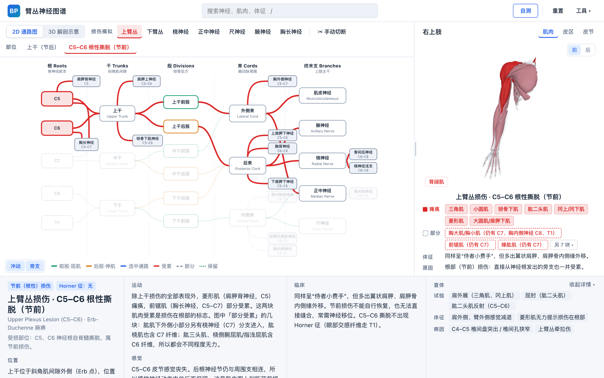
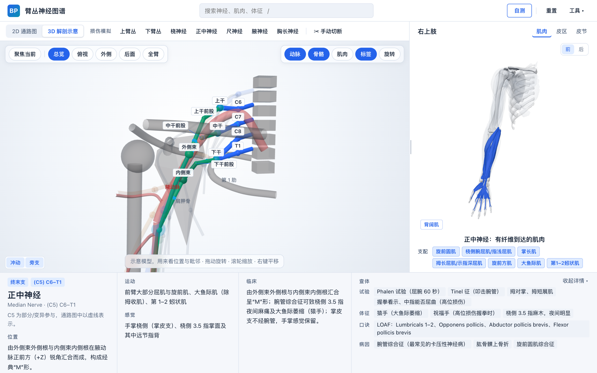

# 臂丛神经联动可视化 · Brachial Plexus Atlas

交互式臂丛神经学习工具：从 C5–T1 神经根到上肢肌肉和皮区，点选任意结构即可双向溯源，并模拟各平面损伤的表现。


| 损伤模拟：上臂丛 C5–C6 根性撕脱 | 3D 解剖示意：正中神经 |
| :---: | :---: |
|  |  |
| **皮节：C6** | **深色主题：桡神经沟损伤** |
|  |  |

## 功能

- **2D 通路图**：根 → 干 → 股 → 束 → 终末支及主要旁支，只沿真实纤维路径高亮。
- **上肢联动图**：肌肉、皮区、皮节三种模式；肌肉页是可旋转的真实网格，点肌肉或皮区可反向溯源到神经。
- **损伤模拟**：上/下臂丛、桡、正中、尺、腋、胸长神经，按损伤平面给出瘫痪、部分受累、保留的肌肉和体征。
- **自由切断**：切断任意一处或多处结构，实时推算运动、感觉缺失和 Horner 征。
- **3D 解剖示意**：骨骼、动脉、神经走行，用来看位置与毗邻。
- **自测**：定位题、反向题、病例题、自动生成的选择题和错题本。
- 另有搜索、查体卡片、投影模式、打印版式、深色主题；页面状态记在网址里，可直接分享链接。

## 运行

```bash
python3 serve.py
```

然后访问 <http://localhost:8765>（macOS 也可以双击 `start.command`）。页面使用 ES 模块，不能直接双击 HTML 打开；无需安装依赖，可离线使用。

## 开发

```bash
npm test
```

校验纤维路由模型、损伤推导、题库与模型的一致性。纤维路由的唯一数据源是 `js/model.js`。

右上肢网格已生成在 `assets/limb/`。要重新生成，把 [BodyParts3D](https://dbarchive.biosciencedbc.jp/en/bodyparts3d/download.html) 的 `isa_BP3D_4.0_obj_99.zip` 和 `isa_element_parts.txt` 解压到 `raw/`，再运行 `npm run build:limb`。

## 署名

3D 骨骼、动脉、神经走行坐标改编自 [prathusa/anatomy](https://github.com/prathusa/anatomy)（CC BY 4.0）；右上肢肌肉网格来自 [BodyParts3D](https://dbarchive.biosciencedbc.jp/en/bodyparts3d/download.html)（© The Database Center for Life Science，CC BY 4.0）；部分病例改编自 [rjg/brachialplexus](https://github.com/rjg/brachialplexus)（MIT）。详见 [CREDITS.md](CREDITS.md)。

仅供解剖学习，不用于临床诊断。节段按常用教材取值，教材间可相差约一个节段。
