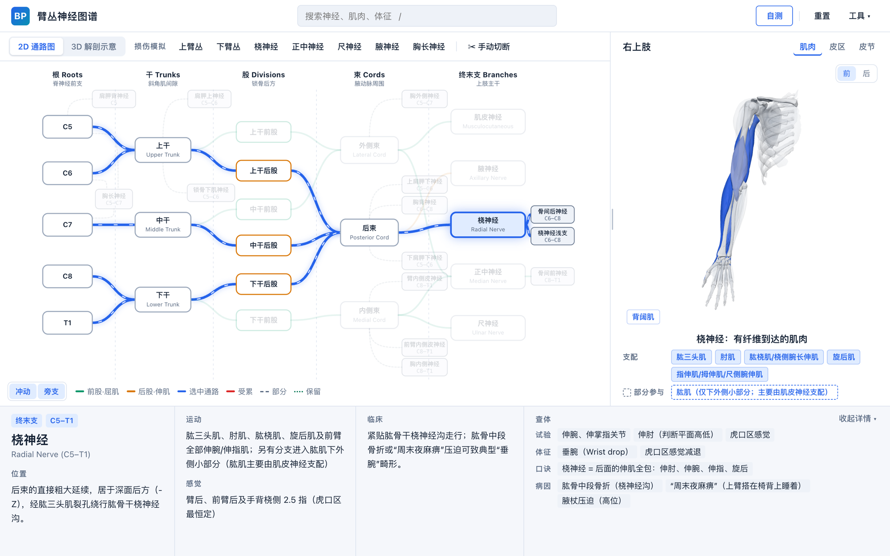
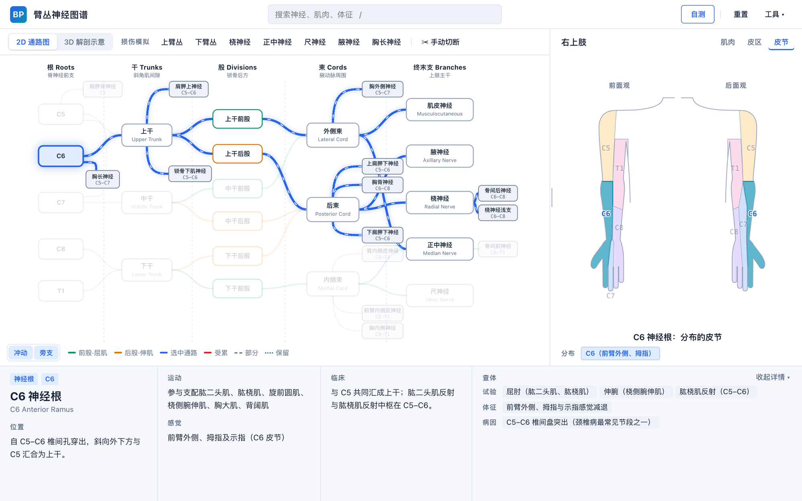
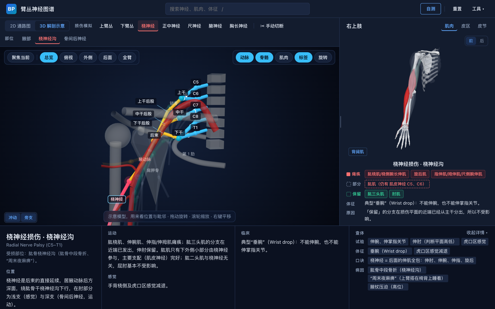

# 臂丛神经联动可视化 · Brachial Plexus Atlas

交互式臂丛神经学习工具：从 C5–T1 神经根到上肢肌肉和皮区，点选任意结构即可双向溯源，并模拟各平面损伤的表现。



| 损伤模拟：上臂丛 C5–C6 根性撕脱 | 3D 解剖：正中神经 |
| :---: | :---: |
|  |  |
| **皮节：C6** | **深色主题：桡神经沟损伤** |
|  |  |

## 功能

- **2D 通路图**：根 → 干 → 股 → 束 → 终末支及主要旁支，只沿真实纤维路径高亮。
- **上肢联动图**：肌肉、皮区、皮节三种模式；肌肉页是可旋转的真实网格，点肌肉或皮区可反向溯源到神经。
- **损伤模拟**：上/下臂丛、桡、正中、尺、腋、胸长、肌皮神经，按损伤平面给出瘫痪、部分受累、保留的肌肉和体征；同一神经可在高位、低位之间切换对比。
- **自由切断**：切断任意一处或多处结构，实时推算运动、感觉缺失和 Horner 征。
- **3D 解剖**：真实的神经走行（Z-Anatomy）叠在 BodyParts3D 骨骼、肌肉上，用来看位置与毗邻；外侧束、内侧束等少数段为补画。选中或损伤时默认「隔离」，只留这条通路、骨骼和相关肌肉；损伤部位标在走行上，点标记切换部位，损伤点以远画成受累。
- **自测**：定位题、反向题、病例题、自动生成的选择题和错题本。
- 另有搜索、查体卡片、投影模式、打印版式、深色主题；页面状态记在网址里，可直接分享链接。

## 使用

**在线版**：<https://iiigary.github.io/brachial-plexus-atlas/>，浏览器打开即可，推送到 `main` 后自动更新。

**本地运行**（无需安装依赖，可离线使用）：

- Windows：双击 `start.bat`，用系统自带的 PowerShell 起本地服务器并打开浏览器；使用期间不要关掉弹出的窗口。
- macOS：双击 `start.command`，或运行 `python3 serve.py` 后访问 <http://localhost:8765>（需要 Python 3）。

页面使用 ES 模块，不能直接双击 `index.html` 打开。

**U 盘离线包**：没有网络的课室可以带一份离线包。

```bash
bash tools/make-usb.sh
```

会在项目根目录生成「臂丛神经图谱-U盘版」文件夹（约 4 MB，只含运行所需文件），整个复制到 U 盘，在目标电脑上按上面的方式启动。

## 开发

```bash
npm test
```

校验纤维路由模型、损伤推导、题库与模型的一致性。纤维路由的唯一数据源是 `js/model.js`。

### 代码结构

没有构建步骤，`js/` 下的 ES 模块由浏览器直接加载。数据单向流动：

```
state.js（选了什么）→ context.js（经 model.js 推导出该高亮什么）→ 各视图与检查器
```

| 文件 | 职责 |
| --- | --- |
| `js/model.js` | 纤维路由模型：拓扑、各神经的节段、支配靶区（zone）、损伤预设与受累推导。纯逻辑，Node 里也能跑 |
| `js/data/` | 节点坐标与说明、上肢图形状、损伤与查体文字、题库 |
| `js/state.js` | 全部交互状态，以及 `clearSelection`、`currentQuiz` 等只读状态的小函数 |
| `js/context.js` | 把 state 翻译成高亮上下文，字段说明见文件里的 `HighlightContext` |
| `js/app.js` | 入口：用户操作 → 改 state → `updateUI()`；事件绑定与快捷键 |
| `js/plexus2d.js`、`js/limb.js`（+ `limb3d.js`）、`js/view3d.js` | 通路图、上肢图（「肌肉」页的网格）、3D 解剖 |
| `js/inspector.js`、`js/quiz.js`、`js/urlstate.js`、`js/search.js` | 底部详情、自测、网址状态、搜索 |

改代码时只有一条规则：改完 state 调 `updateUI()`。SVG 什么时候需要整体重建由 `updateUI` 自己判断，视图不直接改 state，用户操作通过 `init(handlers)` 传回 `app.js`。

几个容易混的词：**zone** 是肌肉、皮区或皮节（上肢图上的一块），`kind` 为 `motor | cutaneous | dermatome`；**level** 是损伤预设里的「部位」（如桡神经的 `groove`）；**plane** 是数字化的平面（0 腋窝 … 4 手），用来判断哪些分支在损伤点近端已经分出。

右上肢网格已生成在 `assets/limb/`。要重新生成，把 [BodyParts3D](https://dbarchive.biosciencedbc.jp/en/bodyparts3d/download.html) 的 `isa_BP3D_4.0_obj_99.zip` 和 `isa_element_parts.txt` 解压到 `raw/`，再运行 `npm run build:limb`。

3D 解剖视图的神经走行已生成在 `assets/plexus/`。要重新生成，需要 Blender 和 Z-Anatomy 的 `Startup.blend`，步骤见 [tools/zanatomy/README.md](tools/zanatomy/README.md)。

## 许可

本项目的原创内容采用 [MIT 许可证](LICENSE)：可以自由使用、修改和分发，保留版权声明和许可声明即可。

下面列出的第三方内容仍按各自的许可证使用，其中 CC BY 4.0 的数据在分发时须保留署名。`assets/plexus/` 采用 CC BY-SA 4.0：修改后再分发须保留署名，并沿用同样的许可证。

## 署名

3D 解剖视图的神经与动脉走行、两个 3D 视图里的背阔肌来自 [Z-Anatomy](https://github.com/Z-Anatomy/Models-of-human-anatomy)（CC BY-SA 4.0）；骨骼、肌肉网格来自 [BodyParts3D](https://dbarchive.biosciencedbc.jp/en/bodyparts3d/download.html)（© The Database Center for Life Science，CC BY 4.0）；部分病例改编自 [rjg/brachialplexus](https://github.com/rjg/brachialplexus)（MIT）。详见 [CREDITS.md](CREDITS.md)。

仅供解剖学习，不用于临床诊断。节段按常用教材取值，教材间可相差约一个节段。
